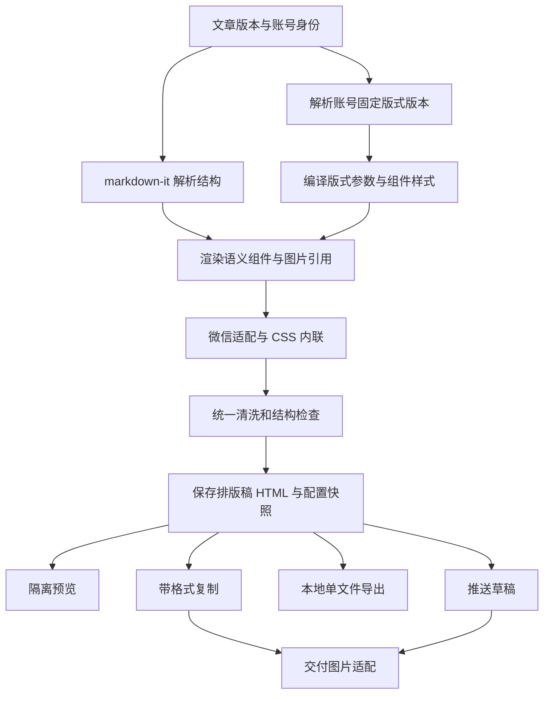

# 公众号固定版式优化方案

日期：2026-10-22。本文是实施设计，开发已开始。已落地账号/平台版式版本、结构化配置与历史快照、标题和正文分离、token 级脚注、隔离预览、公众号正文图片交付；组件参数、品牌首尾文案、标准样稿和结构化 JSON 版式包也已接入。第三批新增“账号定位 → 公众号版式”独立工作台、持久草稿、并发保存/启用检查、本窗口未保存编辑恢复、本账号真实文章预览与三档屏宽。正文图片当前限制为 PNG/JPG 且小于 1 MB，真实微信验收尚未完成。品牌图像资产和目标公众号正式规范仍未完成。依据当前工作区源码及此前上游调研；上游链接使用分支地址，实际复用须固定 commit 并记录来源。没有运行上游项目，也没有完成真实微信粘贴和手机验收。

## 1. 产品目标与推荐路线

本地验证记录（2026-10-22）：`npm test` 全部 124 项通过；`npm run build`（含主进程/渲染进程类型检查）通过；`node scripts/smoke-account-layouts.mjs` 和 `node scripts/smoke-layouts.mjs` 通过。截图位于 `artifacts/account-layout-designer.png` 及窄屏版本。这些检查不包含真实微信账号或手机端验收。

将排版模块升级为“公众号固定版式 + 确定性渲染 + 可追溯交付”。每个公众号配置一次完整视觉规范，此后文章自动使用该版式；版式调整通过新版本生效，旧排版稿保持当时的 HTML 和资产引用。

推荐组合：借鉴 doocs/md 的主题分层和组件语义，选择性适配 WeMD 的内联处理与预览能力，参考 Markdown Nice 的主题设计工作流，使用 lyricat/wechat-format 的兼容案例补充验收样稿。现阶段继续使用项目已有的 markdown-it、juice、highlight.js，在它们周围补齐版式配置和平台适配层。

“统一”包含正文、标题层级、强调、引用、图片说明、列表、分割线及品牌首尾组件；文章章节数量和图片数量可以变化，视觉规则保持一致。AI 可以提出结构建议，最终样式由固定规则生成。

此次用户需求更新了旧 PRD 中“模板不绑定账号”的设定。实施时应同步更新《PRD-排版AI.md》；既有 ADR 0007 的保留渲染基础库决策继续适用，新增 ADR 描述账号版式、版本和交付规则。

## 2. 当前实现与缺口

| 当前事实 | 对用户的影响 | 改进措施 |
|---|---|---|
| article-layout-service.ts 使用 markdown-it → 主题 CSS → juice 内联 | 已具备基础渲染能力 | 拆出主题编译和微信适配，继续使用现有解析器 |
| layout-themes.ts 静态定义 5 个主题，共享 baseCss | 版式差异有限，无法维护某账号的完整视觉规范 | 将主题升级为可保存、可发布版本的版式对象 |
| LayoutsPage 每次生成传 themeId；文章有可选 accountId | 没有账号默认版式自动解析 | 根据文章所属账号和平台身份解析默认版式 |
| ArticleLayout 已保存 HTML、articleVersionId 和 themeId | 可保留历史输出，但无法完整追溯版式和渲染版本 | 增加版式版本、配置快照、渲染版本和资产清单 |
| 服务支持 customCss，当前排版页没有编辑入口；自定义 CSS 从默认绿色基础样式叠加 | 定制能力缺少产品入口，且不是真正基于所选主题编辑 | 建立结构化配置编辑器，受控 CSS 作为高级扩展 |
| 首个 H1 被取为 title，随后又作为 H1 加入正文；发布接口还单独发送 title | 公众号成品可能重复显示文章标题 | 标题元数据和正文标题分开，公众号默认正文不重复标题 |
| renderer/lib.ts 清洗白名单缺少 section、sup、sub、figure、figcaption；生成器已输出 section、sup | 预览可能丢失参考链接容器样式、脚注上标；复制原始 HTML 与预览有差异 | 统一输出清洗策略，验证需要的标签和属性 |
| 预览直接插入应用 DOM，并受 .layout-html 等宿主 CSS 影响 | 未显式设置的样式可能受应用样式影响 | 使用隔离预览容器，已保存稿展示最终产物 |
| 微信发布直接将 layout.html 写入 content；当前上传主要解决封面 media_id | 正文 moliu-asset 地址不能直接作为微信图片交付 | 增加正文图片适配与地址替换，区别封面上传 |
| 微信发布通道固定 wechat-official，凭证为单通道；AccountPlatformBinding 是身份记录 | 多套账号版式不等于已支持多个公众号授权发布 | 第一阶段做账号身份与版式关联，多授权通道另行扩展 |

这些是静态源码观察；“可能发生”的显示差异要用样稿复现，不能把代码检查当成实机兼容结论。

## 3. 开源项目如何借鉴与接入

前序 GitHub 页面显示 doocs/md 约 1.35 万 star、Markdown Nice 约 4700、lyricat/wechat-format 约 4600、WeMD 约 970。数字仅为选型背景，维护状态、模块边界和本项目适配成本决定实际采用方式。

### 3.1 doocs/md：主题分层、组件语义和样式导出

已核对入口：

- [核心包说明](https://github.com/doocs/md/blob/main/packages/core/README.md)
- [主题目录](https://github.com/doocs/md/tree/main/packages/core/src/theme)
- [语义选择器映射](https://github.com/doocs/md/blob/main/packages/core/src/theme/selectorMapping.ts)
- [合并主题导出](https://github.com/doocs/md/blob/main/packages/core/src/theme/themeExporter.ts)
- [许可证](https://github.com/doocs/md/blob/main/LICENSE)

源码事实：核心包使用 marked，提供渲染、主题等模块；README 明确说明 juice 内联在 Web 复制流程中，不包含在核心包里。themeExporter 将变量、基础主题、自定义 CSS 合并导出。selectorMapping 给提示块、代码块等元素提供稳定的语义名称。

借鉴与接入：

1. **主题分层。** 在我们系统中定义基础规则、账号配置、组件变体、受控扩展 CSS，按固定顺序编译。字体、颜色、行距等由配置生成；输出前解析 CSS 变量为实际值，避免微信交付依赖变量和外部样式。
2. **语义组件。** 给章节标题、引用、提示块、图片说明等定义自己的组件类型。通过 markdown-it token 和 renderer rules 生成相应结构，无需迁移 marked 扩展。
3. **完整导出。** 在版式编辑器增加“导出版式”，包含配置、组件版本、可选扩展 CSS、示例文稿和来源说明，支持跨设备恢复。
4. **组件兼容映射。** 若未来支持导入外部 CSS，显式处理根选择器和组件结构差异，返回不支持项；不能仅将 #nice 或 #wemd 替换成 .mly-body 就声称兼容。

落点：拟新增 layout/theme-compiler.ts、layout/component-renderer.ts、layout-template-service.ts；由 article-layout-service.ts 调用。

复用方式：优先自行实现与我们配置模型匹配的编译流程；独立工具函数可在固定来源和许可证后选择性移植。当前整包导入会带入另一套解析器、主题注入机制及相关依赖，收益不足。许可证文件为 WTFPL；实际移植文件还需记录各自来源和依赖。

### 3.2 WeMD：内联处理、定制体验和深色预览

已核对入口：

- [ThemeProcessor.ts](https://github.com/tenngoxars/WeMD/blob/main/packages/core/src/ThemeProcessor.ts)
- [主题样式目录](https://github.com/tenngoxars/WeMD/tree/main/templates)
- [wechatDarkMode.ts](https://github.com/tenngoxars/WeMD/blob/main/packages/core/src/wechatDarkMode.ts)
- [项目功能说明](https://github.com/tenngoxars/WeMD)
- [许可证](https://github.com/tenngoxars/WeMD/blob/main/LICENSE)

源码事实：ThemeProcessor 支持是否内联的选项，并处理代码块空格、横向滚动和对齐；微信深色预览有独立实现。项目声明支持可视化与 CSS 两种主题编辑方式，采用 MIT。

借鉴与接入：

1. **公众号输出处理器。** 将代码空格保护、white-space、文本对齐等兼容规则纳入我们自己的 wechat-adapter.ts。先以真实样稿确认问题，再引入对应规则。
2. **适配 HTML 结构。** 上游部分处理匹配 code 上的 hljs 类，我们当前高亮类在 pre 上；不可直接粘贴其正则。推荐在 token/DOM 层定位代码块，保留语义和缩进。
3. **可视化配置。** 参考“修改属性即看效果”的操作模式，用现有 React 组件实现正文、标题、引用、图片等分组设置；每次预览不创建历史排版稿。
4. **交付预览。** 编辑中可有轻量预览，点击“保存排版稿”时必须生成最终内联、清洗后的 HTML，再展示该产物。内联失败要报告错误，不能退回无样式 HTML 并显示成功。
5. **深色预览。** 后续将经过来源审查和适配的色彩转换封装在 preview-darkmode.ts，只作用于预览副本。复制、导出和发布仍使用正常输出；界面标注“深色效果模拟”，不承诺 README 的百分比还原度。

落点：拟新增 LayoutTemplateEditor.tsx、LayoutPreview.tsx、layout/wechat-adapter.ts、layout/preview-darkmode.ts。

复用方式：MIT 独立函数或文件是优先评估候选，保留版权及许可文本，并补来源记录。模板仅作起点，需要转换为我们的组件规范并做微信验收。深色模块还要核对其引用来源和第三方文件声明，不直接按仓库总体许可证推断所有来源。

### 3.3 Markdown Nice：主题设计工作流与组件覆盖

已核对入口：

- [项目与许可说明](https://github.com/mdnice/markdown-nice)
- [主题目录](https://github.com/mdnice/markdown-nice/tree/master/src/template)
- [基础主题](https://github.com/mdnice/markdown-nice/blob/master/src/template/basic.js)

源码事实：基础主题覆盖正文、标题、嵌套引用、图片说明、表格容器、代码和脚注等，部分样式依赖特定 DOM 结构。项目采用 GPL-3.0。

借鉴与接入：

1. **组件样本页。** 版式编辑器提供同一篇标准样稿，包含所有受支持元素。这样调整一个账号版式时，可一次检查正文到脚注的完整效果。
2. **主题从样本验证到固定使用。** 用户先基于自己的参考文章调样式，确认后启用；日常写文章直接套用该版本。
3. **样式契约。** 每个组件定义“可配置属性 + 生成结构 + 微信降级行为”。例如图片含图片和图注，不能只设置 img 的圆角就算完成图片组件。
4. **高级编辑分离。** 常用属性用表单，高级 CSS 在独立区域。添加高级规则后显示兼容提示，并可单独撤销。

落点：组件清单、固定样稿、版式编辑器、导入预检。账号绑定和不可变版本由我们的系统新增，并非上游已验证存在的功能。

复用方式：本方案采用产品工作流和组件覆盖思路，自行实现代码与样式。若将来要移植 GPL 代码或主题，再明确交付方式和许可证要求；本方案不把“商业使用”和“可闭源复用”混为一谈。

### 3.4 lyricat/wechat-format：平台兼容案例

[仓库说明](https://github.com/lyricat/wechat-format)明确表示停止维护，并提及列表样式被微信重置、外链转文末索引等处理。

借鉴与接入：以嵌套列表、有序列表起始编号、引用内列表、长链接、重复链接等作为兼容验收输入。我们已有外链脚注，但当前用字符串替换链接，可能丢失链接内部加粗等结构；改为 token 处理，保持文本和内部结构，制定重复 URL 的合并规则。

落点：wechat-adapter.ts、脚注组件、平台验收样稿。该项目不作为新依赖或升级来源；停止维护的兼容技巧需要在当前微信环境重新验证，直接移植前另核实授权文件。

### 3.5 其他前序候选的定位

| 项目 | 可参考点 | 在我们系统中的安排 |
|---|---|---|
| [wx-art-formatter](https://github.com/bingo906/wx-art-formatter) | 模板缩略图、主题色预览 | 用在首次创建版式的候选展示；固定版式建立后不鼓励日常反复换主题 |
| [wechat-formatter / TypeZen](https://github.com/mspringjade/wechat-formatter) | 调节正文尺寸、行距、留白等操作 | 参考控件范围；仓库的 AGPL 标注与额外商用声明需进一步厘清，当前不纳入代码复用 |
| [Lifa-su/md2wechat](https://github.com/Lifa-su/md2wechat) | 简单实时预览与复制 | 现有系统已具备基础能力，不作为替换引擎的理由；也不能与此前核验的同名 npm 包认定为同一来源 |
| [DC-WeMark](https://github.com/DylanChiang-Dev/DC-WeMark) | 本地浏览器内处理 | 本项目已有本地处理，现阶段不引入 Rust/WASM 运行链 |
| [Greatbeing/wechat-layout](https://github.com/Greatbeing/wechat-layout) | 参考文章提炼风格的工作流 | 未来用于辅助生成版式草案，生成后仍经过规范校验和人工启用 |
| [bianlipai](https://github.com/843645440/bianlipai) | 原文一致性校验、主题样稿展示 | 参考验收方法；其 Python 上游与授权链单独评估，不进入首期桌面链路 |
| [wechat-design-html](https://github.com/brucecbi/wechat-design-html) | 将设计规范映射到适配微信的样式参数 | 参考规范转参数的方法；用自己的公众号品牌规范建立模板 |

上述补充候选主要基于前序 README 调研，本轮未逐一审计代码；不将其宣传的完全兼容作为验收依据。

## 4. 固定版式需要保存什么

建议版式对象由以下部分组成，而非仅存一段 CSS：

| 部分 | 配置内容 | 用途 |
|---|---|---|
| 识别信息 | 名称、用途、版本号、参考材料说明 | 管理与追溯 |
| 基础参数 | 正文字体栈、字号、行高、颜色、段距、正文内边距 | 控制整体阅读节奏 |
| 标题组件 | 各级字号、字重、间距、对齐、编号/边线变体 | 建立稳定层级 |
| 文本组件 | 加粗、链接、引用、提示块、列表、分割线 | 统一重点表达 |
| 图文组件 | 图片宽度、圆角、上下留白、图注字号与颜色 | 统一图片表现 |
| 扩展组件 | 表格、代码、脚注；后期公式与图表 | 保持复杂内容可读 |
| 品牌组件 | 可选栏目标识、开头说明、尾部署名与固定说明 | 重复使用固定品牌信息 |
| 输出规则 | 正文是否显示主标题、链接策略、代码换行、宽表降级 | 控制公众号最终输出 |
| 资产引用 | 标识图、尾图等资产 ID 与内容摘要 | 备份及历史复现 |
| 来源信息 | 参考项目、实际移植文件、commit、许可及修改摘要 | 维护升级 |

首套样式参数可从正文 16px、行高 1.8、段距 16px、二级标题 20px、三级标题 17px开始调校。这只是无参考材料时的初始值，最终由目标公众号的规范确定。区分预览设备外壳留白和文章自身留白，避免两层叠加使正文过窄。

JSON 是版式配置的唯一权威数据源，编译 CSS 是派生产物。高级 CSS 作为单独覆盖层存储，并有范围、长度、选择器和属性约束；首期禁止外部 @import、脚本行为及不受控的远程资源 URL。常规编辑不要求用户理解 CSS。

## 5. 账号绑定和版本规则

### 5.1 绑定对象与解析顺序

现有 Article.accountId 指向账号画像，AccountPlatformBinding 记录画像下的平台身份。建议支持两级绑定：

1. 具体公众号身份的版式绑定，优先级最高。
2. 账号画像的 wechat 默认版式，用于该画像只有一个公众号或未登记平台身份时。
3. 未关联账号的文章使用全局默认版式，并提示当前来源。

一个画像关联多个公众号身份且版式不同，必须先明确目标身份；系统不能根据最近操作猜测。第一期可先实现画像级默认，数据库预留 platformBindingId；具体身份选择随使用场景启用。

日常生成时默认自动套用。文章级例外使用显式操作“本篇使用其他版式”，记录原因与版本，不能顺便改掉账号默认。账号版式损坏或缺失时展示错误并提供选择，不静默换成绿色主题。

### 5.2 版本生命周期

编辑草稿 → 预览样稿/实际文章 → 启用为新版本 → 后续新稿使用此版本。

- 每次调字号只更新编辑草稿，不产生正式版本。
- 启用时创建不可变版本，并在同一事务中更新账号默认指向。
- 旧排版稿保存原 HTML、文章版本、版式版本和相关资产。打开、复制、导出旧稿不重新渲染。
- “按新版式重新排版”创建新排版稿，旧稿继续可查。
- 回退版式通过重新启用历史配置形成新版本，保留操作历史。
- 仅版式版本落后时提示可更新；文章正文版本落后时继续执行当前发布前校验，要求重新生成。
- 历史版本被引用时允许归档，不物理删除；品牌图片也需保留引用，不能删除后让旧稿缺图。

### 5.3 建议新增数据结构

| 表或字段 | 建议字段 | 规则 |
|---|---|---|
| layout_templates | id、name、platform、status、draft_config_json、draft_revision、created_at、updated_at | 保存版式实体及可编辑草稿；revision 用于避免编辑覆盖 |
| layout_template_versions | id、template_id、version_number、schema_version、config_json、compiled_css、component_schema_version、source_manifest_json、config_hash、created_at | 发布后不可变；模板内版本号唯一 |
| account_layout_bindings | id、account_profile_id、platform、platform_binding_id 可空、template_version_id、updated_at | 绑定明确版本；画像默认和具体身份分别建立唯一约束，避免 SQLite NULL 唯一性漏判 |
| article_layouts 新字段 | template_version_id、layout_config_snapshot_json、render_engine_version、content_hash、target_identity_snapshot_json、asset_manifest_json | 均兼容旧数据为空；保留原 HTML、theme_id 等字段 |
| 发布图片映射表 | asset_hash、wechat_app_id、purpose、remote_url/media_id、created_at | 区分正文图 URL 与封面 media_id，按目标公众号隔离缓存 |

配置 schema_version 与渲染器版本分别记录：配置没变不代表升级引擎后能得到完全相同的 HTML。历史复现优先直接读取已保存 HTML。

## 6. 渲染和交付如何嵌入现有系统

共同产物是已清洗的正文 HTML；预览、复制、导出、发布共用其内容结构。不同目的地只处理必要的资产 URL 和文档外壳，并记录处理结果。深色模拟不回写共同产物。

### 6.1 结构处理

- 用 token 判断第一个一级标题，避免在代码块中误识别以 # 开头的文本。
- 公众号 title 保存为元数据，正文默认不重复主标题；如品牌需要正文标题，可在版式中开启。网页导出可有独立标题显示策略。
- 正文通过稳定的组件结构生成。Markdown 图片输出块状图片组件，alt 文本同步作为图注；装饰编号使用真实 span 等节点，不依赖伪元素才能显示的关键内容。
- 外链脚注在 token 层转换，保留加粗、图片等内部结构；正文纯文本从解析结果生成，逐步替换现有正则去 Markdown。
- 普通引用与摘要/提示块要有明确语义标记，不根据一段文字长度随机决定卡片样式。
- 文本内容、顺序、数字和链接目标保持一致；固定品牌文案单独记录，避免内容校验把它误判成 AI 改写。

### 6.2 平台适配与预览

- 微信适配规则集中维护，采用已验证属性集合；支持有边界的组件变体。不要把“内联 CSS”当作“全部 CSS 都可用”。
- 修复 section、sup、sub、figure、figcaption 等生成结构与清洗规则不一致的问题；允许属性也要覆盖有序列表 start 等实际需求。
- 将 HTML 内容清洗和 CSS 规则校验分开；保留 style 属性并不等于已经完成 CSS 兼容检查。
- 主进程提供最终清洗结果，预览可再做防御性检查，但不能悄悄改变已保存稿的结构。检查差异时应暴露原因。
- 预览组件使用 sandbox iframe 等隔离方式，不启用文章脚本；验证 Electron 下本地图片协议与 iframe 的加载行为，并配置相应资源策略。
- 375px 为默认，可切换较窄和较宽设备；这属于近似阅读预览，真实微信的字体与样式处理仍需外部验收。
- 宽表、长代码提供横向展示或显式降级，不能让整篇文章横向溢出。复杂表格转图可以作为后续用户主动选择，不能默认丢掉文本可访问性。

### 6.3 图片和发布

已落地发布准备步骤：

1. 草稿推送和“上传正文图并复制”都会扫描本地图片引用，校验资产并单独上传正文图。
2. 已使用的图片地址按公众号 AppID、资产 URL 和文件摘要缓存；封面仍使用自己的素材 `media_id` 路径。
3. 上传结果只替换交付副本的图片 src，保存的版式稿仍保留本地资产引用；本地 HTML 导出仍使用现有内嵌图片流程。
4. 图片格式或大小不符合接口限制时，推送/复制明确失败并显示需要重导或压缩的图片。
5. 联网上传只由“上传正文图并复制”或草稿推送按钮触发，普通预览不上传。

当前首版正文图片只接受 PNG/JPG 且小于 1 MB；真实公众号账号下的图片显示仍待验收。

## 7. 页面与操作流程

### 7.1 账号设置中的“公众号版式”

已实现入口：“账号定位 → 选择账号 → 公众号版式”。无文章时也可配置，草稿保存在本地数据库；启用创建新版本并更新绑定，冲突时保留草稿并要求更新基准。实现说明见 ADR 0010。

显示当前版式名称、启用版本、预览缩略图和更新时间。提供“编辑版式”“查看历史版本”“导入/导出版式”。初次设置从少量预设或空白规范创建，完成后绑定到当前账号。

若用户提供详细版式说明，开发时将其映射到配置和组件；未覆盖的组件以同一视觉规范补齐，并在样稿中明确展示。已有参考文章可以辅助提炼，但只凭截图无法准确还原所有字号、间距及微信兼容行为，提炼结果先作为草案。

### 7.2 版式编辑器

左侧是正文、标题、强调、引用、图片、列表、页尾等组件导航；中间是手机预览；右侧是当前组件参数。提供“标准样稿/选择我的文章”切换，便于同时检查完整组件和真实内容。

“保存草稿”和“启用版式”分开；退出未保存编辑有提示。可恢复当前启用版本的参数。高级 CSS 折叠展示，导入 CSS 时列出已接收、已转换和不支持规则。固定品牌文案与图片单独编辑。

### 7.3 文章排版页

选择文章后，自动显示“来自账号 A 的版式 · 第 3 版”。主要操作为查看预览、调整配图位置、保存排版稿、复制和去发布。主题图库主要用于创建或编辑账号版式。

切换文章/账号后重新解析目标版式；异步预览响应带请求编号，防止较慢的旧响应覆盖新文章。字体等连续调整防抖，预览不写入 article_layouts。只有显式保存才产生一个交付版本。

文章没有账号时，使用全局默认并清楚标明；多个公众号身份存在歧义时要求用户选目标。模板的升级提示与文章正文过期提示分别处理。

### 7.4 发布页

展示文章版本、版式版本和目标公众号；当前单通道凭证不能用账号画像名称冒充已授权的多个公众号。未来多通道支持需要显式身份映射，并将 token、图片缓存等按 appId 隔离。

发布前检查正文版本和图片准备状态；固定版式的历史版本允许使用，但显示当前版本差异。外部草稿修改与本地版式升级不能自动相互覆盖。

## 8. 模块改造清单

下表路径相对仓库根目录；标注“新增”的文件为建议落点，尚未创建。

当前实现中，草稿与启用事务在 database.ts，入口校验在 ipc.ts；独立工作台在 components/layout/AccountLayoutPanel.tsx，复用的参数控件和预览文档位于同目录。后续模块拆分应保留这些已完成行为。

| 文件/模块 | 改造责任 |
|---|---|
| src/shared/contracts.ts | 版式、版本、账号绑定、预览和生成接口类型 |
| src/main/database.ts | 新表、增量迁移、事务启用、历史引用、默认版式解析所需查询 |
| src/main/services/layout-template-service.ts（新增） | 保存编辑草稿、校验、启用、绑定、导入导出、历史版本 |
| src/main/services/layout/theme-compiler.ts（新增） | 配置转 CSS、组件配置合并、变量落值、受控 CSS 校验 |
| src/main/services/layout/component-renderer.ts（新增） | token 转组件 HTML，标题、引用、图注等稳定结构 |
| src/main/services/layout/wechat-adapter.ts（新增） | 列表、代码、脚注、输出标签等微信适配 |
| src/main/services/layout/output-policy.ts（新增） | 最终 HTML 清洗与结构检查；与前端约束一致 |
| src/main/services/article-layout-service.ts | 编排解析、绑定版本选择、预览与保存；返回版本快照 |
| src/main/services/layout-themes.ts | 保留旧主题兼容入口，新预设作为创建版式的种子 |
| src/main/services/layout-assets-service.ts（新增） | 图片引用、正文图上传适配、目标账号图片映射 |
| src/main/services/wechat-publish-service.ts | 接入交付图片准备，维持当前文章版本校验与失败记录 |
| src/main/services/workspace-service.ts | 版式包导入导出、备份包含品牌资产；区分文章原稿和排版稿导出 |
| src/main/ipc.ts / src/preload/index.ts | 版式 API、输入校验、预览接口与文件交互桥接 |
| src/renderer/src/pages/AccountPage.tsx | 版式入口与当前账号绑定展示 |
| src/renderer/src/pages/LayoutsPage.tsx | 自动套版、无副作用预览、正式保存、例外版式操作 |
| src/renderer/src/pages/PublishingPage.tsx | 显示目标身份、版式版本及图片准备结果 |
| src/renderer/src/components/layout/*（新增） | 编辑器、组件参数、隔离预览、版本列表等 |
| src/renderer/src/lib.ts / styles/pages.css | 清洗规则一致性，去掉对文章预览造成干扰的宿主样式 |
| src/renderer/src/mock-bridge.ts | 与新接口同步，演示态明确真实能力边界 |
| THIRD_PARTY_NOTICES.md | 记录实际复用文件、来源版本、许可和修改摘要 |

建议接口族：layoutTemplates.list/get/saveDraft/activate/listVersions/export/import；accounts.getLayoutBinding/setLayoutBinding；layouts.preview/create。activate 与绑定更新在同一事务内完成。preview 返回 HTML、纯文本、解析到的版式版本、兼容问题，不写正式排版稿。

生成接口不信任前端传来的 HTML。主进程根据 articleId、目标身份和已发布版式版本生成最终产物；若使用编辑草稿预览，保存时仍需要固定一个不可变版式版本。

## 9. 分阶段实施和验收

| 阶段 | 交付范围 | 验收出口 |
|---|---|---|
| A：交付基础 | 标题分离、预览/交付清洗一致、脚注与列表修复、隔离预览、正文图片交付路径 | 同一标准样稿能正确预览、复制、导出；真实微信验证标题不重复、图片可访问、列表与脚注可读 |
| B：账号固定版式 | 模板实体、配置 schema、版本、绑定、自动套用、历史快照、旧数据兼容 | 账号 A 和 B 分别套自己的版式；重启后仍生效；更新 A 的版式不改变旧稿和 B 的稿件 |
| C：详细版式设计 | 进行中：已落地独立账号工作台、持久草稿、组件参数、样稿/真实文章预览、品牌文字组件和结构化版式包；剩余品牌图像资产及目标账号正式规范 | 用户按规范完成一套版式，不逐篇调 CSS；不同文章使用同一组件规则，导出再导入效果一致 |
| D：增强 | 深色模拟、参考文章辅助提炼、结构建议、更多复杂内容组件 | 增强能力不改变原文、不覆盖已启用版式；明确模拟与真实微信的差别 |

阶段 A 与 B 构成系统升级基础，阶段 C 完成用户要求的详细版式配置体验。阶段 D 按实际文章类型再安排。多公众号授权发布是独立扩展，不因增加版式绑定而被隐含视作完成。

实施前先锁定一篇全组件样稿及三篇真实文章：长文、图文混排、包含列表/表格的文章。版式使用相同样稿对照，不用不同内容掩盖样式差异。

建议验收内容：

- 配置与绑定：默认解析优先级、多个身份歧义、非法模板、事务失败回滚、并发编辑 revision。
- 历史追溯：新旧版式并存、旧稿复制 HTML 不变、资产引用不丢失、文章更新后仍阻止发布过期正文。
- 文本保真：正文字符、顺序、数字、引用和链接目标保持一致；代码缩进和表格内容不丢失。
- 页面体验：切文章不串预览，调整参数不产生大量历史稿，深色模拟不影响复制内容。
- 真实交付：分别验证“富文本粘贴”和“草稿 API”两条路径；在微信手机端浅色/深色、至少两类设备上检查。没有真实账号/设备时记录为待验收，不宣布完全兼容。
- 工程检查：修改对应模块后运行相关测试、typecheck 与 build；数据库、版式、发布改动分别执行关联用例。仅在实施阶段运行，不在方案阶段声称已经通过。

## 10. 迁移、回退与依赖控制

1. 新增表并按现有 ensureAddedColumns 模式幂等加列；旧排版稿的新字段为空，继续直接读取原 HTML。
2. 五个旧主题转为可选择的初始预设；不根据旧稿最后一次 themeId 自动猜测某账号的永久默认版式。
3. 老账号首次进入可选择或使用全局默认，新绑定操作明确保存。新版式预览与旧版式历史同时可用。
4. 版式配置与品牌资产加入备份；导入包先校验 schema、组件版本与资产清单，再事务导入。配置包含版本过新时不部分导入后假装成功。
5. 产品级回退可切回旧主题生成流程，历史稿均可读。二进制降级另需验证老应用对新增数据的兼容性，不能只因数据库是增量加列就保证可降级。
6. 不把上游项目整体嵌入 iframe 作为日常工作台，不引入第二套账号、存储和图床设置。仅文章预览使用隔离容器。
7. 需要复用的源文件固定 commit，记录差异与许可；上游更新先用固定样稿比对，再升级。避免默认自动追踪 main 导致账号版式悄悄变化。

## 11. 首批可交付成果

- 一套覆盖常见文章元素的样稿与组件清单。
- 修复预览和实际交付的不一致，完成公众号标题与正文图片处理。
- 一套账号版式的创建、编辑、启用、绑定、历史版本流程。
- 在现有排版页自动套用账号版式，保存可追溯成品。
- 按用户提供的详细规范制作首个公众号的正式版式，并用多篇真实文章验证一致性。
- 将本方案中的新决策同步进排版 PRD、ADR 和第三方来源记录。

具体公众号视觉规范尚未提供；这影响首套品牌配色、字号及组件造型的最终定稿，不影响上述系统结构设计。建议后续材料包括正文/标题规范、首尾组件、图片与引用规则，以及两到三篇期望效果样例。
