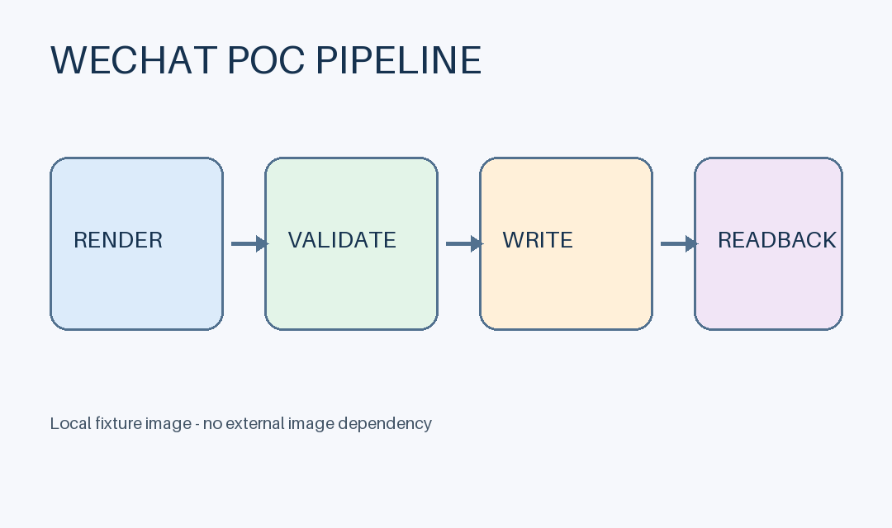

# 微信主题验收

本文包含中文、English、`inline-code`、**加粗** 和 *斜体*，用于比较主题的视觉层级。

> 好的主题是在微信限制内保持清晰、品牌化和可读。

## 1. 列表与代码

1. 确定性渲染。
2. 图片自动处理。
   - 不保留失效外链。
3. 写入后读回。

- [x] 标题与列表
- [ ] 真机回归

```ts
interface ThemeResult { theme: string, valid: boolean }
export const ready = (result: ThemeResult) => result.valid
const longLine = 'renderer -> sanitize -> inline CSS -> validate -> draft -> readback：验证窄屏代码横向滚动'
```

## 2. 表格与图片

| 检查项 | 输入 | 本地校验 | 读回检查 | 失败策略 |
|---|---|---|---|---|
| 代码 | 超长行 | 横向滚动 | 内容一致 | 降级 |
| 表格 | 五列 | 多屏宽度 | 单元格完整 | 阻断 |
| 图片 | 本地 PNG | MIME 与尺寸 | 微信 URL | 不上传 |



## 3. 链接与脚注

规范来自[微信插件开发规范](https://developers.weixin.qq.com/doc/service/guide/product/plugin_spec.html)和[素材管理文档](https://developers.weixin.qq.com/doc/service/guide/product/asset.html)。普通链接：[Example](https://example.com/)。这里还有一个脚注。[^1]

[^1]: 用于验证主题中的脚注、尾注与回链样式。

主题必须同时通过渲染、结构、草稿就绪和图片加载检查。
