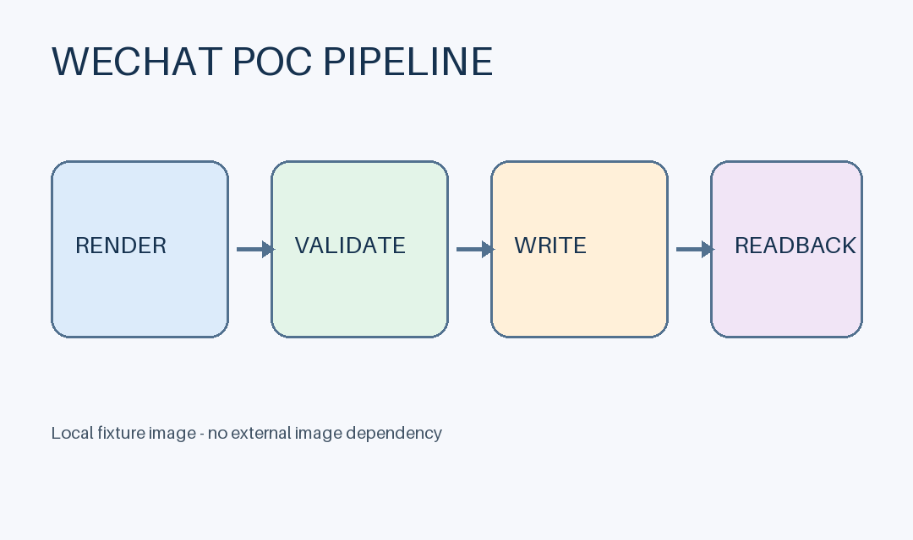

# 公众号真实 POC

本文验证 **Markdown → 微信 HTML → 编辑器读回**，包含中文、English、`draft/add`、**加粗** 和 *斜体*。

> 浏览器预览正常不等于微信兼容完成，写入后必须重新读取并比较。

## 1. 列表与任务

1. 渲染 Markdown。
2. 上传图片并替换地址。
3. 创建测试草稿。
   - 不自动发布。
   - 保留写入前备份。
4. 读回并比较文本。

- [x] 标题与列表
- [x] 代码块与宽表格
- [ ] 真实公众号读回（配置测试账号后执行）

## 2. 代码块

```ts
interface DraftReadiness {
  ready: boolean
  blockers: string[]
}

export function inspect(cover?: string): DraftReadiness {
  return cover ? { ready: true, blockers: [] } : { ready: false, blockers: ['COVER_REQUIRED'] }
}

const longLine = '用于验证窄屏横向滚动的超长代码行：renderer -> sanitize -> inline CSS -> upload -> draft -> readback -> compare normalized text'
```

## 3. 宽表格

| 检查项 | 输入 | 本地检查 | 微信读回 | 失败处理 |
|---|---|---|---|---|
| 标题 | POC 标题 | 32 字上限 | 完整标题 | 阻断 |
| 代码 | 超长行 | 横向滚动 | 文本完整 | 降级 |
| 表格 | 五列 | 多屏宽度 | 单元格内容 | 阻断 |
| 图片 | 本地 PNG | MIME 与大小 | 微信 URL | 不建草稿 |
| 外链 | 官方文档 | 底部引用 | 索引文本 | 保留 URL |

## 4. 本地图片



正文图片必须先转存，不能引用本机路径或任意外链。

## 5. 链接与脚注

规则来自[微信公众平台编辑器插件开发规范](https://developers.weixin.qq.com/doc/service/guide/product/plugin_spec.html)和[素材管理文档](https://developers.weixin.qq.com/doc/service/guide/product/asset.html)。

普通链接：[Example](https://example.com/)。标准脚注也应保留。[^1]

[^1]: 这是用于检查对应关系的 POC 脚注。

## 6. 结论

接口返回成功不等于排版验收通过；任何读回差异都应写入报告。
